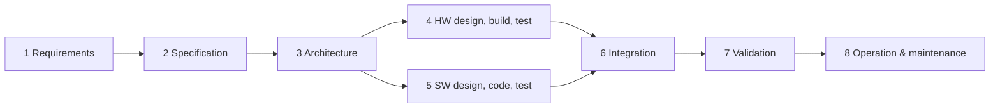
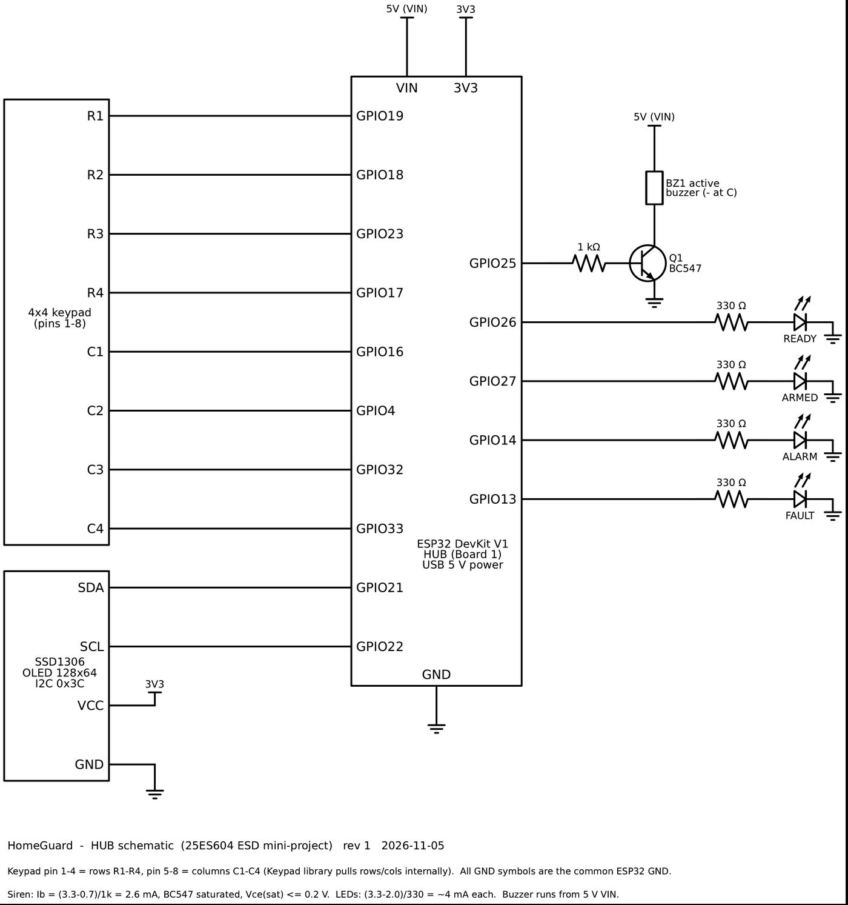
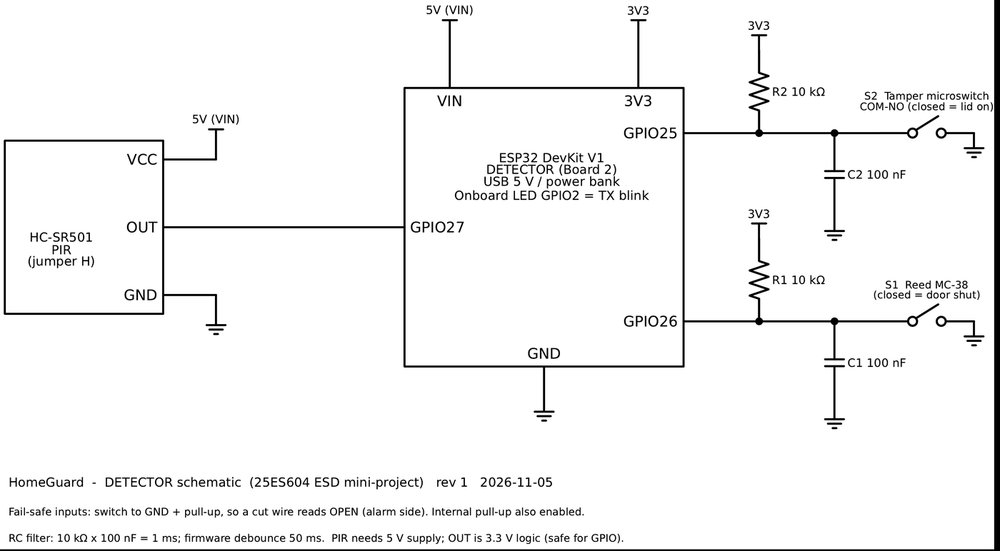

# HomeGuard: ESP32 wireless intrusion detection system

**Design and Implementation of an ESP32-Based Wireless Intrusion Detection System with Tamper and Link Supervision**

Term project for **25ES604 Embedded System Design** (M.Tech Embedded Systems, Amrita School of Engineering, Coimbatore).
Team: **Jothi Prabha R** (EBS26014) and **Linganiveth S G** (EBS26016) · Guide: **Dr. Anju S Pillai** · November 2026.

Two ESP32 boards form a small wireless alarm, in the style of commercial wireless alarm kits:

- a **detector node** (PIR motion, door reed switch, tamper switch) that reports every event over **ESP-NOW**, and
- a **hub** (keypad, OLED, siren, LEDs, phone web page) that runs the alarm state machine.

The project is organised around the **embedded system design flow**: every stage has its own folder and document, from requirements to operation and maintenance.

## Features

| Feature | How it works |
|---|---|
| Motion, door and tamper detection | HC-SR501 PIR (interrupt), MC-38 reed switch, lever microswitch under the enclosure lid |
| Fail-safe inputs | Switches pull to GND with 10 kΩ pull-ups, so a cut wire reads as "open" (alarm side) |
| Debouncing | 10 kΩ × 100 nF RC filter (τ = 1 ms) + 50 ms software window |
| Reliable radio link | 12-byte packet with sequence number and CRC-16; ACK after action, 100 ms timeout, 3 tries, duplicate filter |
| Supervision | Heartbeat every 5 s; hub reports **DETECTOR OFFLINE** after 15 s of silence |
| Alarm logic | 5-state FSM: DISARMED → EXIT DELAY (30 s) → ARMED → ENTRY DELAY (15 s) → ALARM; tamper alarms in any state |
| Security | 4-digit PIN from keypad or phone; 3 wrong PINs lock both for 60 s |
| User interface | 4×4 keypad, SSD1306 OLED, 4 LEDs, buzzer, web page on the hub's own Wi-Fi (no router or internet needed) |

## Repository map

| Folder | Design-flow stage | Contents |
|---|---|---|
| [`docs/01_requirements`](docs/01_requirements) | 1 Requirements | Use cases, FR1–FR8, NFR1–NFR5, constraints |
| [`docs/02_specification`](docs/02_specification) | 2 Specification | Measurable spec, timing constants, pin maps, [packet protocol](docs/02_specification/protocol.md), [board MACs](docs/02_specification/board_ids.md) |
| [`docs/03_architecture`](docs/03_architecture) | 3 Architecture | Block diagram, HW/SW partition, design decisions |
| [`docs/04_hardware`](docs/04_hardware) | 4 HW design | Circuit calculations, power budget, component choice |
| [`docs/05_software`](docs/05_software) | 5 SW design | Firmware structure, protocol, alarm state machine |
| [`docs/06_testing`](docs/06_testing) | 4 + 5 Testing | HT1–HT6, ST1–ST11 and serial logs |
| [`docs/07_integration_validation`](docs/07_integration_validation) | 6 + 7 | Integration steps, latency, range, traceability matrix |
| [`docs/08_operation_maintenance`](docs/08_operation_maintenance) | 8 O&M | User guide, maintenance, troubleshooting, limitations |
| [`docs/learning`](docs/learning) | All | Step-by-step build lessons (concept → build → check) |
| [`docs/daily_log`](docs/daily_log) | Progress | Master checklist and one log per working day |
| [`docs/report`](docs/report), [`docs/slides`](docs/slides) | Submission | Project report (DOCX + PDF), review slides, demo plan |
| [`hardware`](hardware) | HW implementation | Schematics (PDF/PNG), bill of materials, photos |
| [`firmware`](firmware) | SW implementation | Detector and hub firmware, shared `packet.h`, test sketches L01–L05 |
| [`tools`](tools) | Support | Schematic generator, `packet.h` sync, latency analysis |

## What you need

Full list with prices: [`hardware/bom`](hardware/bom). Core parts (≈ ₹2,000):

- 2 × ESP32 DevKit V1 (ESP32-WROOM-32) and 2 USB **data** cables
- HC-SR501 PIR, MC-38 reed switch, lever microswitch, small ABS box (detector)
- 4×4 membrane keypad, SSD1306 0.96" I2C OLED, 5 V active buzzer, BC547, 4 LEDs (hub)
- Resistors 10 kΩ ×2, 1 kΩ ×1, 330 Ω ×4; 100 nF ×2; breadboards and jumper wires
- A USB power bank for the detector (so it is truly wireless)

## Reproduce it

1. **Toolchain.** Install Arduino IDE 2.x. In *Boards Manager* install **esp32 by Espressif Systems** (core 3.x; 2.x also compiles). Select **ESP32 Dev Module**.
2. **Libraries.** In *Library Manager* install **Adafruit SSD1306** (accept Adafruit GFX) and **Keypad** by Mark Stanley, Alexander Brevig. `WiFi`, `WebServer` and `esp_now` come with the core.
3. **Wire both boards** from the schematics:

   | Hub (Board 1) | Detector (Board 2) |
   |---|---|
   |  |  |

4. **Read each board's MAC address.** Flash [`firmware/test_sketches/L01_board_check`](firmware/test_sketches/L01_board_check) to each board and note the *STA MAC* printed at 115200 baud.
5. **Set the peer addresses.** Put the hub's MAC in `HUB_MAC` in [`detector_node.ino`](firmware/detector_node/detector_node.ino) and the detector's MAC in `DET_MAC` in [`hub.ino`](firmware/hub/hub.ino). (The values in the repo are this project's boards.)
6. **Optional unit tests.** Run L02–L05 in [`firmware/test_sketches`](firmware/test_sketches) to check the radio link and each hardware block (see [`docs/learning`](docs/learning)).
7. **Flash the firmware.** `firmware/detector_node` → detector, `firmware/hub` → hub. Open both serial monitors at 115200.
8. **Check.** The hub prints `HUB ready … open http://192.168.4.1` and, within a few seconds, `Detector ONLINE`; the hub's green READY LED turns on.
9. **Use it.** Keypad: `1234` `A` arms (30 s exit delay), `1234` `#` disarms, `*` clears. Phone: join Wi-Fi **HomeGuard-Hub** (password `homeguard123`), turn mobile data off and open `http://192.168.4.1`.
10. **Test.** Follow [`docs/06_testing`](docs/06_testing) (HT1–HT6, ST1–ST11) and [`docs/07_integration_validation`](docs/07_integration_validation).

Change the PIN, Wi-Fi password and timings in the configuration block at the top of `hub.ino`.

## Results so far

| Measurement | Result |
|---|---|
| Radio link (HT6, same desk) | 0 lost in 452 consecutive pings; round trip 2.4–3.0 ms typical, 28.8 ms max |
| PIR (HT2) | 5/5 walk-pasts detected; output HIGH 1.06–2.55 s |
| Switch inputs (HT3) | One debounced event per action even with up to 31 raw bounces |
| Status LEDs (HT5) | All 4 pass |
| Phone page (ST10) | Pass |

Remaining results are recorded in [`docs/06_testing`](docs/06_testing) as they are measured.

## Documents

- Report: [`docs/report/HomeGuard_Project_Report.pdf`](docs/report/HomeGuard_Project_Report.pdf) (editable: `.docx`)
- Slides: [`docs/slides/HomeGuard_ESD_Review.pptx`](docs/slides/HomeGuard_ESD_Review.pptx)

## License

MIT, see [LICENSE](LICENSE).
