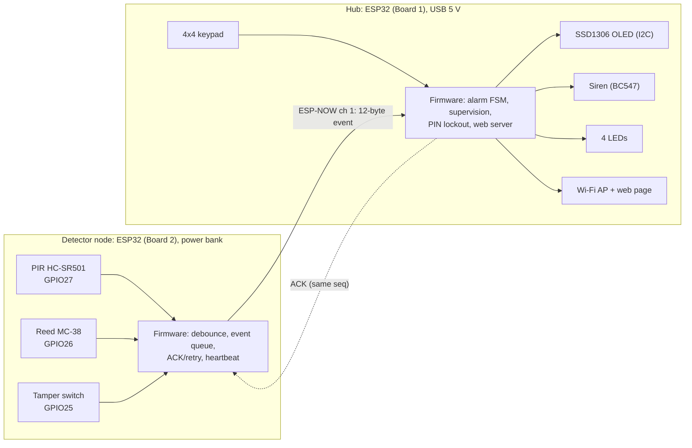

# Stage 3: System architecture

## Hardware/software partition

| Function | Node | Hardware | Software |
|---|---|---|---|
| Motion sensing | Detector | PIR module | Interrupt flag, warm-up gate |
| Door and tamper sensing | Detector | Switches, pull-ups, RC filter | 50 ms debounce, change detection |
| Event delivery | Both | ESP32 radio | Packet, CRC, ACK, retry, duplicate filter |
| Supervision | Both | — | Heartbeat (detector), 15 s timeout (hub) |
| Alarm decision | Hub | — | Finite state machine |
| User input | Hub | Keypad matrix, Wi-Fi AP | Key scan, PIN check, lockout, web form |
| Alarm output | Hub | Transistor driver, LEDs, OLED | Siren control, LED logic, display refresh |

## Key decisions

- **Two microcontrollers.** The detector sits at the door, the panel inside. The detector only senses and reports; every decision is made by the hub, so the alarm policy lives in one place.
- **ESP-NOW.** Built into the ESP32, peer-to-peer by MAC, a few milliseconds of latency, no router. Wi-Fi/MQTT would stop working when the home network is down; LoRa or Zigbee would need extra radios.
- **No RTOS.** A few activities with millisecond deadlines; a non-blocking super-loop where interrupts and callbacks only queue data is simpler to verify.
- **Shared radio on the hub.** The soft access point runs on channel 1, the same channel as ESP-NOW, so one radio serves both the detector link and the phone page.

## Component selection

| Function | Part | Reason |
|---|---|---|
| MCU | ESP32 DevKit V1 ×2 | Built-in Wi-Fi (ESP-NOW + soft AP), 3.3 V I/O, cheap |
| Motion | HC-SR501 PIR | Passive, µA standby, 3.3 V digital output, adjustable |
| Door | MC-38 reed switch | No power needed at the contact |
| Tamper | Lever microswitch (NO) | Pressed by the closed lid |
| Display | SSD1306 OLED, I2C | Two signal wires, 3.3 V |
| Keypad | 4×4 membrane | 16 keys from 8 GPIOs |
| Siren | 5 V active buzzer + BC547 | On/off control only; transistor switches 5 V |
