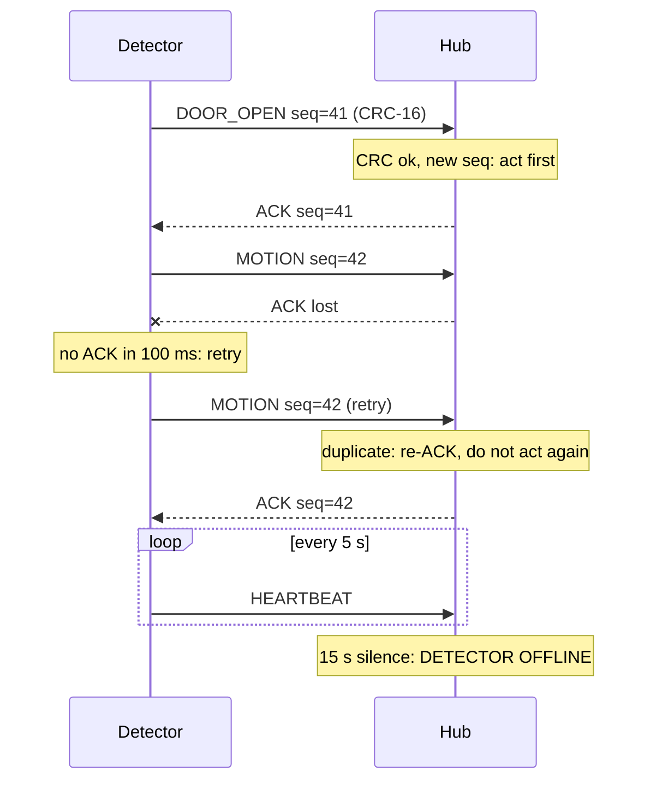
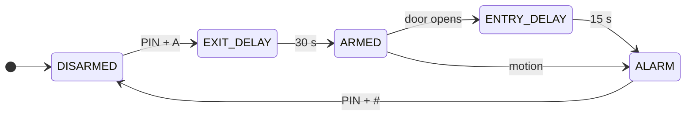

# Stage 5: Software design

Source: [`firmware/`](../../firmware). Protocol details: [`../02_specification/protocol.md`](../02_specification/protocol.md). Build lesson: [`../learning/07_firmware_protocol_fsm.md`](../learning/07_firmware_protocol_fsm.md).

## Structure: non-blocking super-loop

No `delay()` in `loop()`, no application RTOS tasks. Interrupts and the radio callback only copy data and set a flag; all decisions happen in `loop()`.

| Node | Interrupt / callback | `loop()` order |
|---|---|---|
| Detector | `onPirRise()` (IRAM_ATTR, rising edge): sets flag + timestamp. `onRecv()`: accepts only valid ACKs | PIR warm-up gate → motion event → debounce reed and tamper → heartbeat → `serviceTx()` (send / wait ACK / retry) |
| Hub | `onRecv()`: length + CRC check, copy into 8-entry SPSC ring buffer | drain RX queue → `handleEvent()` → keypad → `tick()` timers and supervision → outputs → OLED (every 250 ms) → web server |

## Protocol

- New event → next sequence number; packet sealed with CRC-16/CCITT (poly 0x1021, init 0xFFFF).
- Hub ACKs **after** acting, so an ACK means "handled". The siren is switched on before the ACK is sent.
- Detector retries after 100 ms, 3 transmissions in total, then logs `SEND FAILED`.
- Hub ignores a repeated sequence number (re-ACKs only); bad CRC is discarded.

## Alarm state machine (hub)

| Current state | Event | Next state | Action |
|---|---|---|---|
| DISARMED | PIN + A, lid closed, detector online | EXIT DELAY | 30 s countdown, chirp each second |
| DISARMED | PIN + A, lid open or detector offline | DISARMED | "Cannot arm" |
| EXIT DELAY | 30 s elapsed | ARMED | ARMED LED steady |
| ARMED | DOOR_OPEN | ENTRY DELAY | 15 s countdown, chirps |
| ARMED | MOTION | ALARM | Siren on |
| ENTRY DELAY | 15 s elapsed | ALARM | Siren on |
| any | TAMPER | ALARM | Siren on (24-hour zone) |
| EXIT DELAY / ARMED / ENTRY DELAY / ALARM | PIN + # | DISARMED | Siren off |
| ALARM | 3 min elapsed | ALARM | Siren stops, state stays ALARM until PIN |
| any | 3rd wrong PIN | unchanged | Keypad and phone locked 60 s |

Alarms latch: closing the lid or the door does not silence the siren; only a valid PIN does.

## Outputs

| Output | Behaviour |
|---|---|
| READY LED | DISARMED, detector online, lid closed |
| ARMED LED | Steady when ARMED; blinking during exit/entry delay |
| ALARM LED | On in ALARM |
| FAULT LED | Detector offline or lid open; blinking during PIN lockout |
| Buzzer | Continuous in ALARM (max 3 min); 40 ms chirp per second during delays; 40 ms chirp every 10 s while offline |
| OLED | State, countdown or last event, detector status, PIN stars or lockout timer; refreshed every 250 ms (a full I2C frame takes ≈ 23 ms at 400 kHz) |
| Web page | `/` status + last 20 events, refreshes every 2 s (not while typing a PIN); `/cmd?pin=&act=arm|disarm` |

## Implementation notes

- Shared definitions live in [`firmware/common/packet.h`](../../firmware/common/packet.h); each sketch folder holds a copy (Arduino only compiles files inside the sketch folder). Run `python tools/sync_packet_h.py` after editing it.
- All types are defined in headers or before the first function, because the Arduino IDE inserts auto-generated prototypes before the first function.
- The ESP-NOW receive-callback signature differs between ESP32 core 2.x and 3.x; the code selects it with `ESP_ARDUINO_VERSION_MAJOR`.
